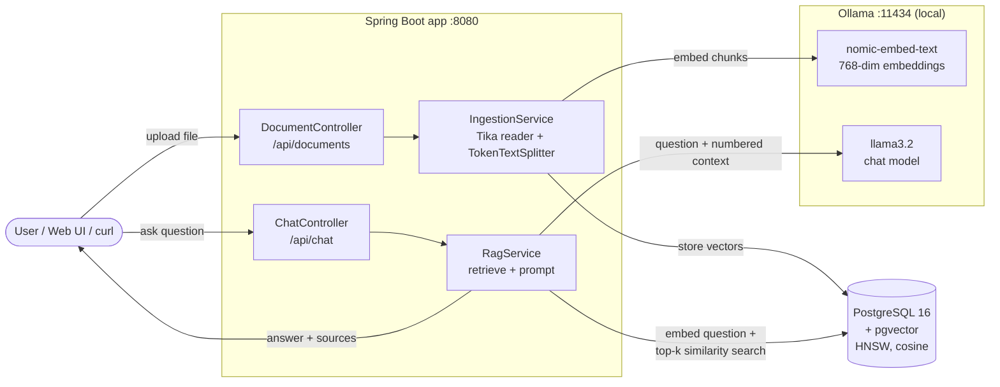

# Spring AI RAG – Chat with your documents, 100% local

**Upload PDFs, Word files or notes and ask questions about them. A local LLM answers using only your documents and cites its sources.**

[](https://github.com/munolishivaraj-cell/spring-ai-rag/actions/workflows/ci.yml)


[](LICENSE)

## What this demonstrates

- **Retrieval-Augmented Generation (RAG)** built end to end with **Spring AI**: read → chunk → embed → store → retrieve → generate.
- **Vector search** in **PostgreSQL + pgvector** (768-dimension embeddings, HNSW index, cosine distance).
- **Local LLMs with Ollama** (`llama3.2` for answers, `nomic-embed-text` for embeddings). No API keys, no data leaves the machine.
- **Grounded answers with citations**: the prompt restricts the model to the retrieved chunks and returns `[1] [2]` references plus source excerpts.
- **Document parsing** of PDF, DOCX, Markdown, text and code with **Apache Tika**.
- **Clean REST API** with Bean Validation and RFC 7807 `ProblemDetail` errors, plus a small web UI.
- **Testing at two levels**: fast unit tests with a mocked `ChatClient`/`VectorStore`, and an end-to-end test that starts **real pgvector and Ollama containers with Testcontainers**.
- **CI with GitHub Actions** on every push and pull request.

## Demo

▶️ **Demo video:** _coming soon – [add your link here](https://example.com/replace-with-demo-video)_

Run the same demo yourself in one command (after [starting the app](#run-it-locally-windows)):

```powershell
.\scripts\demo.ps1
```

It uploads [`samples/acme-robotics-handbook.md`](samples/acme-robotics-handbook.md) and asks three questions, printing each answer with its sources and response time.

<details>
<summary><b>Script for a 1–2 minute demo recording</b></summary>

| Time | Show | Say |
|---|---|---|
| 0:00–0:15 | This README and the architecture diagram | "A RAG service in Spring Boot and Spring AI. It answers questions about your own documents with a local LLM, so nothing leaves the machine." |
| 0:15–0:30 | Terminal: `docker compose up -d`, `ollama list`, app starting | "PostgreSQL with pgvector stores the vectors; Ollama runs llama3.2 and the nomic embedding model." |
| 0:30–0:55 | Run `.\scripts\demo.ps1` | "The handbook is split into chunks, embedded and stored. Each question is embedded, the closest chunks are retrieved, and the LLM answers only from them, with citations." |
| 0:55–1:20 | Browser at http://localhost:8080: upload a PDF, ask a question, point at the sources | "Any PDF or Word file works. The sources show which chunk the answer came from and how similar it was." |
| 1:20–1:40 | Ask something not in the document | "If the answer isn't in the documents, it says so instead of making something up." |
| 1:40–2:00 | `RagService.java`, then the green CI badge / test run | "Retrieval and generation are about 30 lines with Spring AI. Unit tests mock the LLM, and an integration test runs real pgvector and Ollama containers." |

</details>

## Architecture



**Ingestion:** Apache Tika extracts text → `TokenTextSplitter` makes ~800-token chunks → Ollama embeds each chunk → pgvector stores it with its source file name.
**Question:** the question is embedded → pgvector returns the top-k most similar chunks above a similarity threshold → the LLM gets a numbered context and must answer only from it, citing `[n]`.

| Layer | Code |
|---|---|
| REST API | [`DocumentController`](src/main/java/com/shivaraj/rag/web/DocumentController.java), [`ChatController`](src/main/java/com/shivaraj/rag/web/ChatController.java), [`GlobalExceptionHandler`](src/main/java/com/shivaraj/rag/web/GlobalExceptionHandler.java) |
| Ingestion (read, split, embed, store) | [`IngestionService`](src/main/java/com/shivaraj/rag/service/IngestionService.java) |
| Retrieval + generation | [`RagService`](src/main/java/com/shivaraj/rag/service/RagService.java) |
| Settings | [`application.yml`](src/main/resources/application.yml), [`RagProperties`](src/main/java/com/shivaraj/rag/config/RagProperties.java) |
| Web page | [`index.html`](src/main/resources/static/index.html) |

## Tech stack

Java 17 · Spring Boot 3.5 · Spring AI 1.1 · Ollama (llama3.2, nomic-embed-text) · PostgreSQL 16 + pgvector · Apache Tika · Docker Compose · JUnit 5 · Mockito · Testcontainers · GitHub Actions

## Run it locally (Windows)

**Prerequisites:** JDK 17+, [Docker Desktop](https://www.docker.com/products/docker-desktop/), [Ollama](https://ollama.com/download). Maven is not needed; the wrapper downloads it.

Open **PowerShell** in the project folder:

```powershell
# 1. Download the models (about 2.3 GB, one time)
ollama pull llama3.2
ollama pull nomic-embed-text

# 2. Start PostgreSQL + pgvector (container "pgvector", port 5432, db ragdb, user/password postgres)
docker compose up -d

# 3. Start the app (the first run downloads Maven into .mvn\)
.\mvnw.cmd spring-boot:run
```

Then open **http://localhost:8080**, upload a file (or click **Ingest docs/ folder**) and ask a question. Or run `.\scripts\demo.ps1` in a second PowerShell window.

Stop the app with `Ctrl+C` and the database with `docker compose down`. To delete all stored documents: `docker compose down -v`.

> Port 8080 must be free. If PowerShell blocks the demo script, run: `powershell -ExecutionPolicy Bypass -File .\scripts\demo.ps1`

## API

| Method | Endpoint | Body | Returns |
|---|---|---|---|
| `POST` | `/api/documents` | multipart form, field `file` (PDF, DOCX, MD, TXT, …, max 20 MB) | chunks stored per file |
| `POST` | `/api/documents/ingest-folder` | – | ingests every file in `docs/` |
| `POST` | `/api/chat` | `{"question": "..."}` (1–2000 chars) | answer + numbered sources |
| `GET` | `/actuator/health` | – | `{"status":"UP"}` |

Errors are returned as RFC 7807 `ProblemDetail` JSON: `400` for validation errors or an empty upload, `500` if Ollama or the database is unreachable.

### Example requests (PowerShell)

```powershell
# Upload a document (curl.exe is built into Windows 10/11)
curl.exe -F "file=@samples\acme-robotics-handbook.md" http://localhost:8080/api/documents

# Ask a question
$body = @{ question = "How many days of paid leave do employees get?" } | ConvertTo-Json
Invoke-RestMethod -Method Post http://localhost:8080/api/chat -ContentType "application/json" -Body $body

# Ingest the docs/ folder
Invoke-RestMethod -Method Post http://localhost:8080/api/documents/ingest-folder
```

Example response from `/api/chat`:

```json
{
  "answer": "Employees get 24 days of paid leave per year, and up to 10 unused days carry over to the next year. [1]",
  "sources": [
    {
      "index": 1,
      "source": "acme-robotics-handbook.md",
      "score": 0.57,
      "excerpt": "# Acme Robotics – Employee Handbook (sample document) > Fictional company. Used to demo document Q&A..."
    }
  ]
}
```

## Tests

```powershell
.\mvnw.cmd test      # unit tests only (seconds, no Docker needed)
.\mvnw.cmd verify    # unit tests + Testcontainers integration test (needs Docker, ~2 min)
```

| Test | Type | What it checks |
|---|---|---|
| [`RagServiceTest`](src/test/java/com/shivaraj/rag/service/RagServiceTest.java) | Unit (mocked `ChatClient` + `VectorStore`) | top-k/threshold are used, numbered context and sources are built, the LLM is skipped when nothing relevant is found |
| [`IngestionServiceTest`](src/test/java/com/shivaraj/rag/service/IngestionServiceTest.java) | Unit (mocked `VectorStore`) | chunking, source metadata, empty files, folder ingestion |
| [`ApiControllerTest`](src/test/java/com/shivaraj/rag/web/ApiControllerTest.java) | `@WebMvcTest` | JSON contract, validation (400), error handling (500) |
| [`RagApiIT`](src/test/java/com/shivaraj/rag/RagApiIT.java) | Integration, **Testcontainers** | real upload → embeddings → pgvector (768 dims) → llama3.2 answer containing the right fact |

`RagApiIT` starts `pgvector/pgvector:pg16` and `ollama/ollama` containers and reuses the models already in `~/.ollama/models`. CI runs the unit tests on every push; the integration test runs locally because it needs the 2.3 GB of models.

## Configuration

All in [`src/main/resources/application.yml`](src/main/resources/application.yml):

| Property | Default | Meaning |
|---|---|---|
| `spring.ai.ollama.base-url` | `http://localhost:11434` | Where Ollama runs |
| `spring.ai.ollama.chat.options.model` | `llama3.2` | Answering model. `qwen2.5:7b` or `llama3.1:8b` give better answers on a GPU with 8 GB+ |
| `spring.ai.ollama.embedding.options.model` | `nomic-embed-text` | Embedding model. If you change it, update `dimensions` and reset the database |
| `spring.ai.vectorstore.pgvector.dimensions` | `768` | Must match the embedding model |
| `rag.top-k` | `4` | Chunks given to the LLM |
| `rag.similarity-threshold` | `0.4` | Minimum similarity (0–1) for a chunk to be used |

## Screenshots

> Images go in [`docs/screenshots/`](docs/screenshots/). Take them and save with these exact names.

| Screenshot | What to capture |
|---|---|
|  | `web-ui-answer-with-sources.png`: the web page after asking a question, showing the answer and the source excerpts |
|  | `demo-script-output.png`: PowerShell running `.\scripts\demo.ps1` with the three answers |
|  | `web-ui-upload-pdf.png`: uploading a PDF in the web page with the "chunks stored" result |
|  | `pgvector-stored-embeddings.png`: `docker exec -it pgvector psql -U postgres -d ragdb -c "select metadata->>'source', vector_dims(embedding), left(content,60) from vector_store;"` |
|  | `github-actions-ci-green.png`: the green CI run on the GitHub Actions tab |

## Notes and next steps

- Uploading the same file twice stores it twice; `docker compose down -v` resets the database.
- `RagService` writes retrieval out step by step for clarity. Spring AI can do the same with `QuestionAnswerAdvisor` in one line.
- Ideas: streaming answers (Server-Sent Events), chat memory for follow-up questions, per-document metadata filters, JWT authentication, a Dockerfile and cloud deployment.

## License

[MIT](LICENSE) © Shivaraj Apparao Munoli
